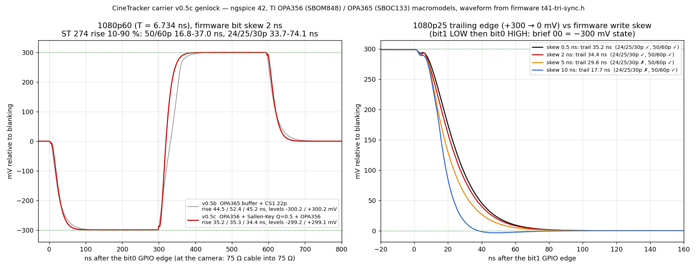

# Genlock output stage: SPICE simulation

These ngspice simulations sized the tri-level sync output stage of the carrier: R-2R ladder, OPA356 buffer, Sallen-Key low-pass, OPA356 line driver, 47 µF DC block and 75 Ω into a 75 Ω cable and termination. The input waveform is the firmware's GPIO sequence from `lib/t41-tri-sync/src/t41-tri-sync.h`: 44 T segments, with T = 1/74.25 MHz at 24/25/30p and 1/148.5 MHz at 50/60p.

## Results (ngspice 42, TI OPA356 PSpice model)

| Case | −300 / +300 mV level | 10–90 % rise, lead / mid / trail |
|---|---|---|
| 25p, 0.5 ns gap between the two trailing-edge writes | −299.2 / +299.1 mV | 35.2 / 35.3 / 35.2 ns |
| 60p, 2 ns gap | −299.2 / +299.1 mV | 35.2 / 35.3 / 34.4 ns |
| 25p, 5 ns gap | same | trail 29.6 ns |
| 25p, 10 ns gap | same | trail 17.7 ns, −3.5 mV dip |
| R and C all +2 % (RC +4 %) | same | 36.6 / 36.7 / 35.8 ns |
| R and C all −2 % (RC −4 %) | same | 33.8 / 33.9 / 33.0 ns |
| 3.3 V rail −1 % | −296.2 / +296.1 mV | 35.2 / 35.3 / 34.3 ns |

**SMPTE ST 274:2008 §10 limit:** rise time 4 T ± 1.5 T, which is 33.67–74.07 ns at 24/25/30p and 16.84–37.04 ns at 50/60p.

- The stage is centred in the overlap of the two windows, 33.67–37.04 ns.
- The trailing edge used to depend on how far apart the firmware's two GPIO writes landed. The firmware now writes both bits in a single store (commit `ab11050`), so the gap is zero by design. **This is not yet measured on hardware.**

**Level tolerance (`mc_levels.py`, 400k runs):**
- With 1 % resistors and a ±1 % rail (3σ), 96.8 % of boards land within ±6 mV.
- With 0.1 % ladder resistors, about 100 % do.

## Files

| File | What it is |
|---|---|
| `sim2.py` | Netlist generator and measurements for the current stage (two OPA356 + Sallen-Key) |
| `sim.py` | The v0.5b single-OPA365 stage, kept for the before/after comparison |
| `sweep.py` → `sweep-results.log` | Write-gap, RC tolerance and rail sweeps |
| `run_waveforms.py`, `plot_waveforms.py` | The six cases in the plot (`python3 run_waveforms.py . b60,60_2,25_0.5,25_2,25_5,25_10`, then `python3 plot_waveforms.py`) |
| `mc_levels.py` | Monte Carlo of the tri-level amplitudes from the ladder equations |
| `genlock-25p.cir`, `genlock-60p.cir` | Standalone netlists with a 2 ns write gap |
| `ideal.lib` | Pin-order wrapper (`OPA356W`) |

**Name mapping:**
- `R5a` in the scripts is R15 on the board (5k6 to +3V3A).
- `sk=(RF1, RF2, CF1, CF2)` are the Sallen-Key parts.
- The netlists add 1 pF of assumed stray capacitance to each filter capacitor and 2 pF to the ladder node.

**TI model files are not included because of TI's licence.** Download them and put them in this folder:
- `OPA356.lib`, from [SBOM848](https://www.ti.com/lit/zip/sbom848).
- `OPA365.lib`, from [SBOC133](https://www.ti.com/lit/zip/SBOC133). This one is only needed for `sim.py`.

The OPA356 zip has the model as `OPA356_PSPICE_AIO/OPA356.LIB` (upper case); rename it to `OPA356.lib`, the netlists include it in lower case. **Don't commit TI's files:** they're TI copyright ("All rights reserved") and can't go into this CERN-OHL-S tree. `git status` will show them as untracked; leave them that way.
