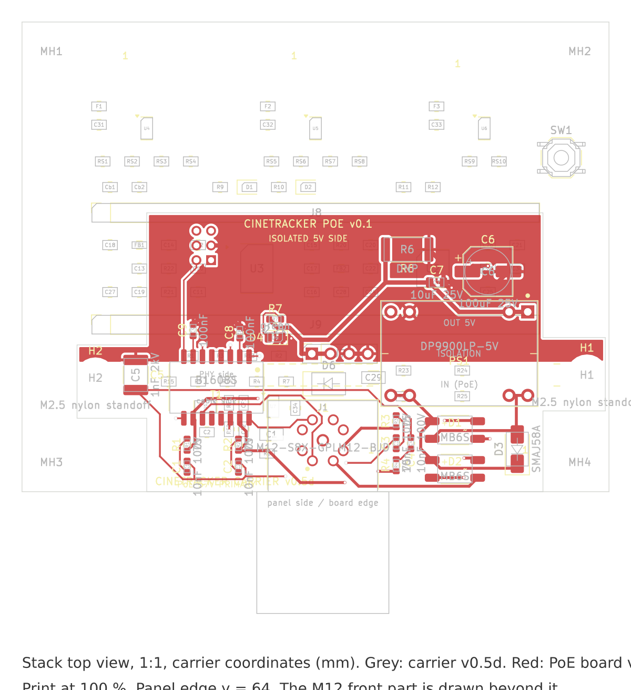

# CineTracker PoE board

The PoE board sits on top of the Teensy 4.1, above the carrier.

- **Connector:** an M12 X-coded Ethernet socket on the panel edge.
- **Power:** an isolated 802.3af PoE powered device (SDAPO DP9900LP-5V module) makes 5 V for carrier J7.
- **Ethernet:** passes 100 Mbit Ethernet through PoE magnetics (CND-tek B1608S) to the Teensy's six Ethernet pins.

**Revision: v0.1 (2026-10-10).** Designed, not built or ordered. Prototype orders are planned together with carrier v0.6.

## Board

| | |
|---|---|
| Size | 72 × 38 mm overall, 2 layers, 1.6 mm. The panel edge is at the same line as the carrier's (y = 64) |
| Coordinates | The KiCad file uses **carrier coordinates**, so J2 lands on the Teensy Ethernet pins and J3 on carrier J7 by construction |
| PoE | M12 X-coded, all 4 pairs. Mode A goes through the magnetics centre taps and Mode B through the spare pairs, so any 802.3af/at PSE works, MikroTik included |
| Output | Isolated 5 V, 1.4 A (7 W at 70 °C). **Minimum load is 100 mA** (R6 is an optional bleeder) |
| Isolation | 3.0 mm band between the PoE side and the isolated side, checked by a custom DRC rule (≥ 2.6 mm; measured 2.7 mm across the 2 kV capacitor C5, ≥ 3.2 mm elsewhere) |
| Mounting | J2 (2×3 2.0 mm socket, bottom) onto the Teensy; J3 (bottom) to carrier J7; two M2.5 **nylon** standoffs; the M12 panel nut |

## Files

| Path | What |
|---|---|
| `cinetracker-poe.kicad_pro` | KiCad 7 project. Open this |
| `cinetracker-poe.kicad_sch` | Schematic, the design source |
| `cinetracker-poe.kicad_pcb` | Routed board, linked to the schematic |
| `cinetracker-poe.kicad_dru` | Custom DRC rule for the PoE isolation spacing |
| `lib/` | Project symbols and footprints: M12 X-coded socket, DP9900LP, B1608S, MBS bridge |
| `fab/` | JLCPCB outputs: Gerbers and drill, BOM, CPL, full BOM with prices, 1:1 stack fit-check PDF |
| `documentation/` | Requirements, design notes, ordering, changelog, open issues, schematic PDF, renders |
| `tools/verify_poe.py` | Checks: schematic vs board, DRC, isolation gaps, and the mechanical match with the carrier |

## Checks done on v0.1

- **Schematic vs board:** the netlist exported from the schematic matches the board, with 26 parts, 24 nets and 85 pads identical. Every footprint is linked to its symbol, with the same value and footprint.
- **DRC (KiCad 7, project rules):** 0 violations and 0 unconnected.
- **Isolation:** every primary-to-isolated gap under 4 mm is listed. The smallest is 2.7 mm (C5, 2 kV), then 3.2 mm.
- **Carrier fit:** J3 pads match carrier J7 pads in position and net. J2 pads match the Teensy Ethernet pins (PJRC) with the right nets. The standoff spots are 5.5 mm and 3.75 mm from the nearest carrier copper or courtyard.
- **Not done:**
  - ERC (KiCad 7's command line has none).
  - Anything on hardware.

## Open

- **J3 to J7 link:** this needs a decision. A standard header cannot bridge the about 10.4 mm gap. See [documentation/open-issues.md](documentation/open-issues.md).
- **Sample checks:** the M12 sample and cordset (pin mapping, panel position), the real stack heights, and the real 5 V load.

Licence: the firmware is AGPL-3.0-or-later (see the repository root). **The hardware licence is not decided yet.**
